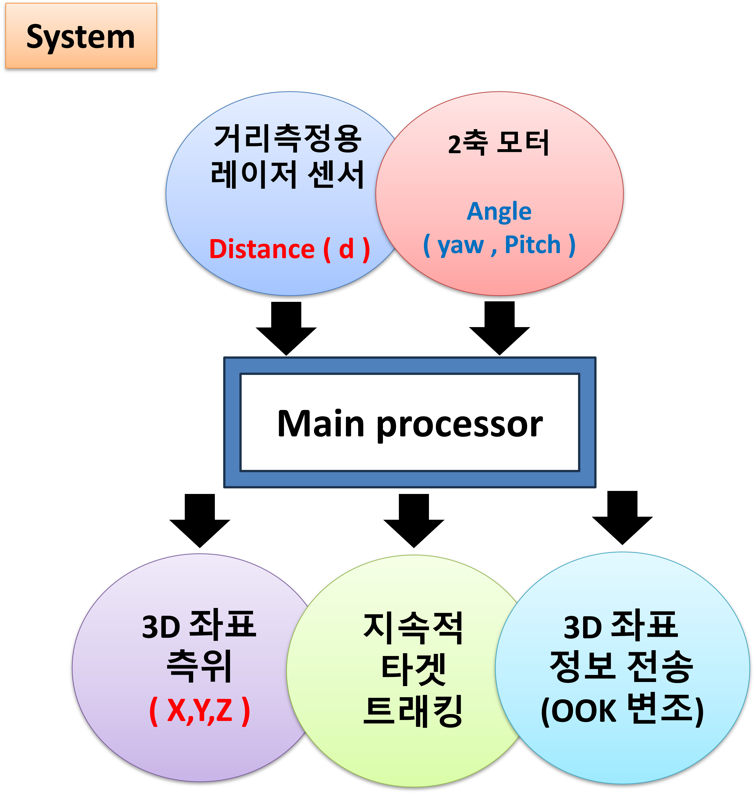
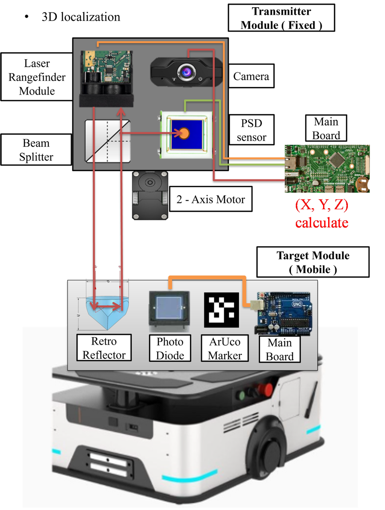
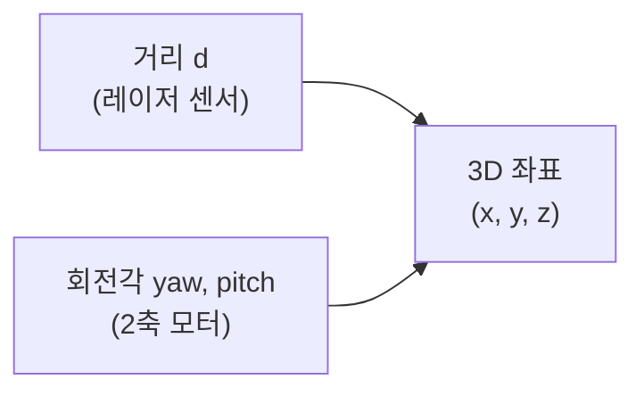
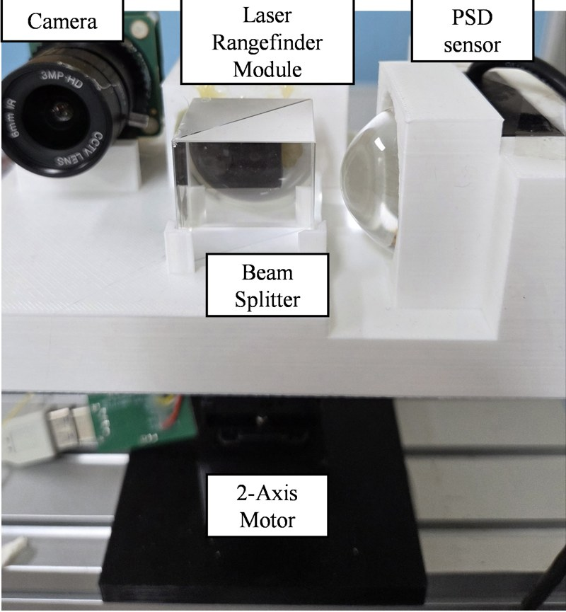
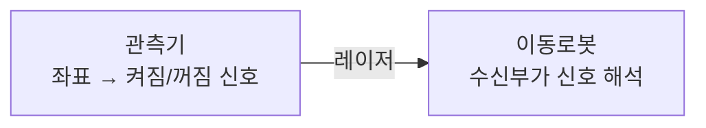
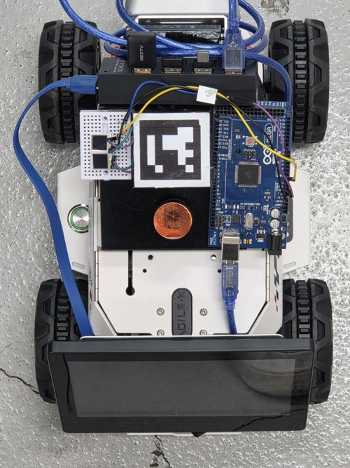

# 프로젝트 1. 카메라-PSD 센서 퓨전 기반 2축 모터 트래킹 & 위치 측정 및 정보 전송 시스템 제작

| | |
|---|---|
| **개발 기간** | 2025.10 ~ 2026.07 |
| **담당 역할** | 시스템 하드웨어 기획 및 제작 / 시스템 소프트웨어 & PID 제어기 제작 |

## Project summary

레이저 센서 기반 로봇의 위치 측위 & 지속적인 레이저 조준을 위한 모터 제어 & 정보 전송

---

## 문제 정의

물류로봇의 위치 측위는 AMR, AGV 방식이 주류이나 각각 한계가 존재함

- **AMR** (SLAM): 주행에 따른 오차 누적
- **AGV** (QR 코드·테이프): 실내 인프라 설치 부담이 큼

---

## 해결을 위한 접근

| | 기술 | 목적 |
|---|---|---|
| 1 | 레이저 거리측정 센서 활용 | 고정된 관측기 기준, 로봇의 3D 위치 측정 |
| 2 | 카메라 & PSD 센서 활용 컨트롤러 설계 | 2축 모터 제어로 레이저의 지속적인 타겟 조준 |
| 3 | 레이저 변조 활용 | 관측기에서 측정한 위치 정보를 로봇에 전송 |

---

## 핵심 기술

### 1. 레이저 거리측정 기반 3D 위치 측정

레이저로 로봇까지의 **거리 d**를 재고, 2축 모터의 **회전각(yaw, pitch)** 을 결합해 관측기 기준 로봇의 3D 좌표 (x, y, z)를 계산함

### 2. 카메라 & PSD 센서 기반 지속 트래킹

로봇이 움직여도 레이저가 계속 로봇을 향하도록 2축 모터를 피드백 제어함

| 센서 | 역할 |
|---|---|
| 카메라 | 광범위 탐색 (ArUco 마커로 로봇 탐색) |
| PSD 센서 | 정밀 조준 (레이저 빔이 들어오는 위치를 정밀 측정) |

### 3. 레이저 변조 기반 정보 전송

레이저를 켜고 끄는 신호(켜짐 = 1, 꺼짐 = 0)로 좌표 정보를 담아 보내고, 로봇의 수신부가 이를 읽음

---

## 결과 및 성취

> 작성 예정
